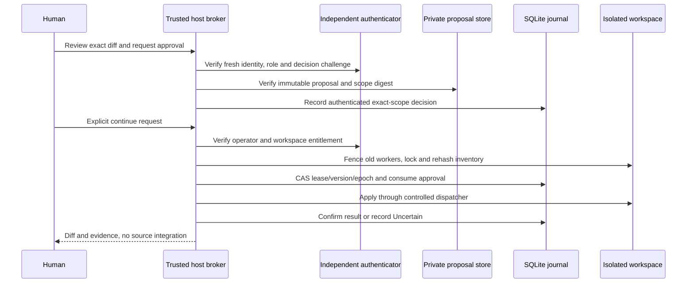

# L2 independent approval and continuation — design only

Status: proposed, no approval/continue CLI or privileged continuation API enabled.
Baseline 082d46fa6d48, version 0.8.0. Existing in-session trusted-host L2 remains
available; the CLI still stops pending approval. No OpenAI/native session is resumed.

## Actual gaps and trust boundaries

DurableApprovalService already verifies an injected independent credential verifier
and harness:approver role. SQLite binds requester, operation/argument scope, approval,
expiry and single-use consumption. patch.apply rejects requester self-approval.
However ownerSession in decide/prepare/start prevents reopening an old operation
as executable. EngineeringPatchEngine proposals live only in an in-memory map;
get rejects unknown proposals. Checkpoints store bounded state/counts, not full
proposals/policies/receipts. inspectEngineeringRecovery deliberately blocks any
non-Completed operation, including a pending approval. Removing those restrictions
would create a bypass, not safe continuation. No deployed IdP exists in the repository.

The model, project files and diagnostic IDs are untrusted. A local execution ID,
boolean --approve, OS login name, telemetry span or checkpoint cannot authenticate
an approver or grant a continuation lease. Host filesystem/journal/verifier remain
trusted. Same-UID hostile races remain outside the demonstrated boundary.

## Host services and conceptual commands

Commands would follow the existing harness status conventions under an explicit
engineering group: status --id, diff --id, approve --id and continue --id. They are
not currently commands. Host configuration selects a private state root and IdP;
model/project paths cannot choose it. Status/diff require authenticated read access
for that workspace, bounded sanitized output, and redacted diagnostics. Viewing a
sensitive full diff is an explicit authorized action, never telemetry.

Approval uses DurableApprovalService through a host broker or authenticated local
IPC endpoint with peer binding. A production verifier must validate issuer, audience,
signature, expiry, nonce/replay and authorized role/workspace entitlement. Prefer an
OS-protected channel or short-lived credential from a separate login flow; no bearer
credential in argv, environment dumps, checkpoints or SQLite. Browser/IdP integration
requires separate selection and review; fixture identities are not authentication.
Authentication occurs outside SQLite transactions; a short-lived verified actor is
bound to the exact decision challenge. Requester and approver must differ by issuer
and subject; issuer aliases need a host identity-normalization policy.

## Durable proposal artifact and binding

A future host-only ProposalArtifactStore must persist a versioned, bounded canonical
artifact before reporting ApprovalPending: execution/requester identity; operation
ID/task/request IDs; workspace receipt ID and ownership; current full snapshot digest;
source/base revision; exact StructuredPatch and patch digest; affected normalized
paths and operations; exact policy/version/digest; content/result/base hashes; diff
digest; creation/expiry; host manifest version and artifact digest. Sensitive code
belongs only in a private content-addressed 0600 artifact under a 0700 host root,
not telemetry or public logs. No arbitrary source path is accepted from --id.
No raw approver credential is persisted. Verified approver identity, decision time,
challenge/artifact/scope digests and expiry are durably audited.

Persist artifact by bounded no-follow/exclusive operations, fsync file and directory
where supported, then bind its digest in the journal transaction. Filesystem/SQLite
are not one atomic transaction. An orphan or mismatched artifact is preserved and
blocked; missing or partially written data cannot be regenerated by a model. Retention
and confidential deletion require explicit host policy. An authenticated manifest
or host-secret MAC held outside the project is needed if tamper detection beyond
same-user file ownership is required; a content hash alone is not authentication.

## Continuation state machine and fencing

Proposed host lifecycle: ProposalPersisted -> ApprovalPending -> Approved ->
ReconciliationRequired -> ContinuationReady -> Applying -> Applied -> ReviewPending.
These are design states, not additions to existing engineering/durable enums.
Denied/Expired/Revoked/Cancelled stop; Uncertain blocks; Completed is never replayed.
A future journal schema/API extension must atomically acquire an execution lease with
monotonic fencing epoch, previous owner/version, actor, expiry and artifact/snapshot
binding. The current ownerSession check stays until that migration is implemented
and validated. A live old worker must be fenced; process absence alone is insufficient.
Stale locks or Running/Prepared/Uncertain require independent quiescence/effect
reconciliation. Never reassign their lease and rerun merely because time elapsed.

continue authenticates an authorized operator, opens/validates SQLite integrity and
all bounded rows/events, resolves the host manifest by ID, locks the workspace,
checks owner/receipt/TTL, rehashes the complete real inventory, and checks original
base identity, patch/artifact/diff digests, exact paths/operations, current policy and
approval actor/expiry/revocation. No new calls to OpenAI occur. A policy change,
concurrent edit, changed revision, missing artifact or expired approval stops before
permission consumption; a revised proposal needs a fresh human decision.

Only an authenticated unconsumed approval for a reconciled Pending/Approved operation
with no possible prior application can become ContinuationReady. A reviewed future
import API may load the exact persisted patch into a new engine after recomputing
all hashes and policy; it must not masquerade as a new model proposal. Dispatcher
remains mandatory. Within a short transaction, CAS validates lease/epoch/version,
actor and exact scope, consumes the one-use approval and records Prepared. No model,
filesystem I/O or verifier runs inside that transaction. Recheck fencing and expiry
before Running and at each mutation boundary. A concurrent loser gets conflict, never
an alternative request ID with duplicate effects. Multi-file application stays
non-atomic; uncertain outcomes retain evidence and require host reconciliation.

After effects, verify full resulting inventory and durably record Completed before
claiming applied. A commit acknowledgment gap, crash, partial write, late persistence,
lease loss or uncertain cleanup produces Uncertain; no automatic replay. Checkpoints
are derived progress evidence and cannot overrule journal/workspace reality. Final
review and any later promotion into the original repository are separate approvals.

## Errors, recovery and acceptance plan

Fixed errors: authentication_required, forbidden_scope, artifact_missing,
artifact_invalid, approval_expired, approval_mismatch, policy_changed,
snapshot_changed, lease_conflict, reconciliation_required, storage_uncertain.
Never include credentials, raw SQL, private paths or patch contents in errors.

Required future tests use real temporary files and SQLite reopen plus fake trusted
IdP only in deterministic tests: forged/wrong-audience/expired credentials; self-
approval; changed patch/base/policy/paths; changed workspace inventory/links; missing
artifact; expiry/revocation at consume/start; simultaneous approvers/continuers;
old live worker fenced; crash before/after each artifact/journal boundary; consumed
approval replay; Running/Prepared/Uncertain reopen; partial effects; unknown commit
acknowledgment; bounded logs; zero provider calls on continuation; unchanged original
project. At least two real processes must test lease ownership and crash races.
No test model determines that a security gate passed. A production IdP/IPC threat
review, migration/rollback plan and independent security acceptance precede enabling
approve/continue. L3 and promotion/deployment remain out of scope.

## Expiry and revision details

The current baseRevision is a digest of the host-selected file inventory, not a
Git commit SHA or a full-repository attestation. Continuation may re-read only that
authorized source scope and the bounded private workspace inventory; it grants no
unrestricted scan of the original repository. Origin metadata and any optional Git
revision must be separately host-recorded and cannot replace content hashes.

An expired/denied/revoked approval cannot be revived by a boolean or by changing
a deadline. The current terminal Cancelled operation stays terminal. A future
explicit reapproval request can create a distinct child operation/request generation
under the same execution, linked to the original operation and immutable artifact,
only after fresh authenticated review, full reconciliation and CAS under the fenced
execution lease. It must record why the predecessor is known to have no effects.
Running/Prepared/Uncertain predecessors cannot use this path; they remain blocked
until trusted effect/quiescence reconciliation. No model call or hidden duplicate
request ID is used to reconstruct an already persisted patch.

This design does not claim tested cross-session execution: only conservative
reopen/expiry/stale-workspace rejection is implemented and validated in this phase.
The proposed authentication broker, artifact import and lease/migration mechanisms
need a separate reviewed implementation before activation.

## Proposed interaction (not enabled)

Continue would require a separately configured operator entitlement (for example,
harness:operator plus exact workspace/execution scope). An approver role alone does
not imply operator authority. Role names beyond existing harness:approver remain
proposed, with no deployed authenticator or grant in this phase.

A fencing epoch is cooperative admission, not an OS guarantee that an old process
cannot finish an in-flight rename. Host-mediated quiescence/worker exclusion and
reconciliation remain mandatory. If they cannot be proved, continuation stays
blocked. Same-UID hostile filesystem races and non-atomic multi-file effects remain
explicit limits; no lease or success test establishes exactly-once external effects.

The artifact also needs a bounded copy/digest of original host budgets, consumed
request/token/iteration counters, reported-versus-unknown usage and cost provenance.
Continuing an apply-only operation uses a newly authorized finite host deadline;
it does not reset original accounting or permit another provider turn. Unknown
past billing cannot become zero after reopen. An artifact/budget change invalidates
the decision scope. Proposed total artifact size is at most 64 KiB, while the patch
must still satisfy the existing stricter 12 KiB serialized engine limit and current
path/file/byte policy. These are proposed admission limits, not implemented ports.
